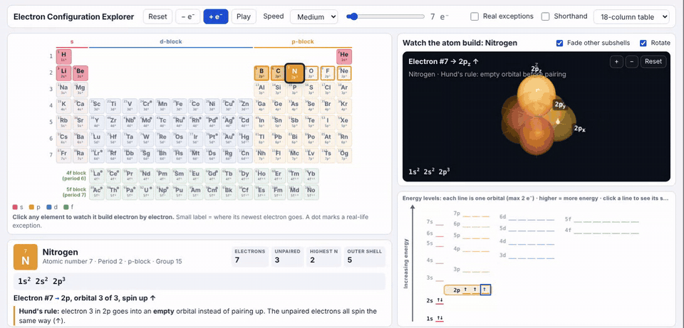
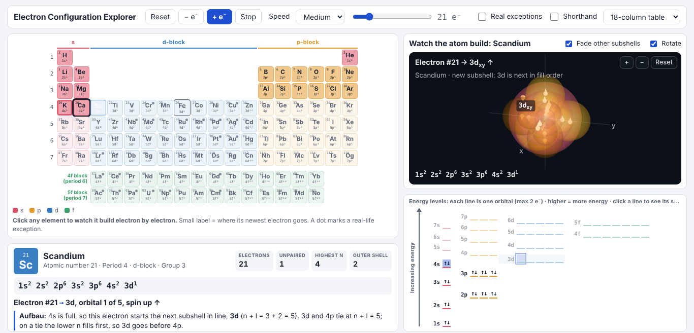

# Electron Configuration Explorer

An interactive periodic table that builds any atom one electron at a time. Click an element and watch each electron drop into the energy-level diagram, fly into its 3D orbital, and get explained by the rule that put it there (Aufbau, Pauli exclusion or Hund's rule).

**Live demo:** https://iamclau.github.io/electron-config-explorer/



I teach high school chemistry, and students often memorize the fill order (1s 2s 2p 3s 3p 4s 3d…) without seeing *why* it happens or what an orbital looks like. This tool puts the periodic table, the energy-level diagram and the 3D orbital shapes on one screen so the connection is visible as it happens.

## Features

- **Build any element:** click it on the periodic table and the atom fills electron by electron, or step forward and back with the arrow keys.
- **Energy-level diagram:** each orbital is a line placed by relative energy, so students can see why 4s fills before 3d.
- **Animated 3D atom:** each electron flies into its orbital. Orbitals are see-through when half full and solid when full, colored by block (s, p, d, f) to match the table.
- **Explanations at every step:** a plain-language reason for each electron's placement, including the n + l rule and tie-breaking.
- **Real exceptions:** toggle on the true configurations of Cr, Cu, Pd, Ag, Au, the lanthanides and others, with the reason for each.
- **Orbital shapes:** simple solid models of s, p and d with their nodal planes, plus probability-cloud and slice views of every orbital (up to 7p) showing radial and angular nodes.
- **Whole-atom view:** every occupied orbital of the current atom overlapped, sized with Slater's rules for effective nuclear charge.
- **Classroom-friendly:** fits on one laptop or projector screen, has keyboard controls, works in light and dark mode, and respects reduced-motion settings.



## The science behind it

| What | How it's modeled |
|---|---|
| Fill order | Madelung (n + l) rule, lower n first on ties, through 7p (Z = 118) |
| Orbital filling | Hund's rule (one electron per orbital first, same spin), then Pauli pairing |
| Exceptions | 20 known ground-state exceptions (e.g. Cr [Ar] 3d⁵ 4s¹, Cu [Ar] 3d¹⁰ 4s¹) |
| Orbital shapes | Hydrogen-like wavefunctions ψ = R<sub>nl</sub>(r)·Y<sub>lm</sub>, using real spherical harmonics up to l = 3 |
| Radial nodes | Found numerically from the roots of the associated Laguerre polynomials (n − l − 1 per orbital) |
| Angular nodes | Planes and cones from the spherical harmonics (l per orbital) |
| Orbital sizes in the whole-atom view | Effective nuclear charge from Slater's rules |
| Table layout | f-block as La–Yb and Ac–No, with Lu and Lr in group 3 (the IUPAC-proposed layout, which matches the simple fill order) |

Simplifications: the energy-level diagram shows the standard textbook ordering, not measured energies for a specific atom. Orbital shapes are for a one-electron (hydrogen-like) atom. Configurations beyond about Z = 104 are predictions.

## Run it yourself

No install or build step is needed. Download the repository and open `index.html` in a web browser. An internet connection is needed for the 3D views (three.js loads from a CDN) and the fonts.

## Project structure

```
index.html        Page layout
css/styles.css    All styling (light and dark themes, one-screen dashboard layout)
js/app.js         Element data, filling logic, explanations, and all visualizations
docs/             Screenshot and demo GIF for this README
```

## Built with

- Plain HTML, CSS and JavaScript (no framework)
- [three.js](https://threejs.org/) (r128) for the solid 3D orbital shapes
- HTML Canvas for the probability-cloud and slice views

## How I built it

I designed the features, the classroom workflow and the chemistry content, and checked the science against my chemistry training. I built the code with the AI assistant Claude (Anthropic), iterating on it through testing with my own classes in mind.

## Ideas for next steps

- A quiz mode ("Which orbital does electron #21 go into?")
- Ion configurations (removing electrons, e.g. Fe²⁺ loses 4s first)
- Orbital-energy data for specific atoms instead of the generic diagram

## Related

- [VSEPR Visualization Tool](https://github.com/iamclau/vsepr-visualization-tool) ([live site](https://iamclau.github.io/vsepr-visualization-tool/)): an interactive VSEPR chart, 3D molecule builder, and step-by-step Lewis structure solver.

## License

MIT License. See [LICENSE](LICENSE).

**Author:** Ian McLauchlan
